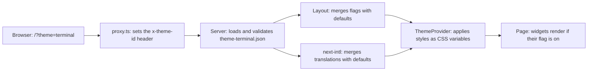

# Architecture Overview

The site is one Next.js 16 App Router codebase that renders different themes from configuration. A theme is a JSON file. It decides the colors and fonts, the wording, and which widgets appear. No theme has its own code.

This page follows a request from the URL to the rendered page, then covers themes, widgets, routes, and the project structure.

## Contents

- [The request flow](#the-request-flow)
- [Themes](#themes)
  - [Adding a theme](#adding-a-theme)
- [Widgets](#widgets)
  - [Adding a widget](#adding-a-widget)
- [Styling](#styling)
- [Routes](#routes)
- [Project structure](#project-structure)
- [Known gaps](#known-gaps)

## The request flow

1. **The theme is chosen by a query parameter.** [proxy.ts](../../proxy.ts) runs before every page request. It reads `?theme=` (falling back to `default`) and copies it into an `x-theme-id` request header, because App Router layouts do not receive search params. In Next.js 16, `proxy.ts` replaces the older `middleware.ts`.
2. **The server loads the theme.** [resolve-theme-id.ts](../../lib/theme/server/resolve-theme-id.ts) reads the header. [theme-loader.ts](../../lib/theme/server/theme-loader.ts) reads `content/custom-themes/theme-{id}.json`, validates it with the Zod schema, and falls back to the default theme for an unknown id. Results are cached per server process in production and re-read on every request in development, so JSON edits show up without a restart.
3. **The layout merges flags.** [app/layout.tsx](../../app/layout.tsx) deep-merges the theme's flags over [default-theme-flags.ts](../../lib/theme/default-theme-flags.ts), sets the theme's emoji as the favicon, and adds a `theme-{id}` class to `<html>`.
4. **next-intl merges translations.** [i18n/request.ts](../../i18n/request.ts) deep-merges the theme's translations over [default-theme-translations.ts](../../lib/theme/default-theme-translations.ts). The locale stays `en`; the theme id is kept separate, since it is not a language.
5. **The providers hand everything to the browser.** [lib/providers.tsx](../../lib/providers.tsx) wraps every page in next-intl's provider and [ThemeProvider.tsx](../../lib/theme/ThemeProvider.tsx). ThemeProvider applies the theme's style overrides as CSS variables on `<html>`, shows the Loader until that is done, and refreshes the page if the URL's theme changes through back or forward navigation.
6. **The page renders the widgets.** [app/page.tsx](../../app/page.tsx) places every widget. Each one reads its flag and renders nothing when the flag is off.

## Themes

Each theme is one JSON file in [content/custom-themes/](../../content/custom-themes/). The file holds only what differs from the defaults; everything else falls through.

| Field | What it does |
|---|---|
| `id`, `displayName` | Required. The id matches the file name (`theme-{id}.json`) and the `?theme=` value |
| `description`, `favicon`, `order` | Optional. Shown in the theme switcher and gallery; `favicon` is an emoji; `order` sorts the list |
| `styles` | Optional groups of CSS values: `colors`, `fonts`, `text`, `iconSizes`, and `spacing` |
| `translations` | Optional wording, grouped by section (`Intro`, `Showcase`, `Classifieds`, and so on) |
| `flags` | Optional switches: `flags.widgets` turns widgets on or off |

The schema is in [theme.zod.ts](../../lib/theme/theme.zod.ts). It defines two shapes: the override shape for the JSON files, where almost everything is optional, and the full shape after the merge with defaults. The TypeScript types come from the same schema, so validation and types cannot drift apart.

**Styles become CSS variables.** [style-utils.ts](../../lib/theme/style-utils.ts) maps each style group to a Tailwind v4 variable prefix, so Tailwind utilities pick up the active theme:

| JSON | CSS variable | Used by |
|---|---|---|
| `styles.colors.accent` | `--color-accent` | `bg-accent`, `text-accent`, `border-accent` |
| `styles.fonts.body` | `--font-body` | `font-body` |
| `styles.text.lg` | `--text-lg` | `text-lg` |
| `styles.spacing.X` | `--spacing-X` | `p-X`, `m-X`, `gap-X` |
| `styles.iconSizes.X` | `--icon-size-X` | icon classes |

Default values live under `:root` in [css/globals.css](../../css/globals.css). When the theme changes, the previous theme's variables are cleared first, so only the active theme's overrides apply.

**The four themes:**

- **Default:** the neutral baseline, with the Showcase cards
- **Newspaper:** newspaper colors and fonts, with the drop cap, news ticker, and classifieds
- **Terminal:** terminal colors and fonts, with the command prompt, typewriter intro, and ASCII welcome box
- **Custom:** every optional widget turned on, to show that any theme can use any widget

### Adding a theme

1. Copy `content/custom-themes/theme-default.json` to `theme-{id}.json`.
2. Set `id` (matching the file name), `displayName`, `description`, `favicon`, and `order`.
3. Add only the `styles`, `translations`, and `flags` that differ from the defaults.
4. Open `/?theme={id}`. The theme appears in the switcher and gallery automatically, with no code change.

## Widgets

A widget is a self-contained part of the home page in [lib/widgets/](../../lib/widgets/). Each one reads its flag through `useThemeFlags()`, returns nothing when the flag is off, and reads its wording from its own translations section. Repeated items such as Showcase cards are discovered from numbered translation keys (`card1Label`, `card2Label`, and so on) by [getIndexedTranslationEntries.ts](../../i18n/getIndexedTranslationEntries.ts), so adding an item needs no code change.

| Widget | Flag | Default | Turned on by | Shows |
|---|---|---|---|---|
| Intro | `typewriterIntro` changes how it appears | Always shown | Typewriter: Terminal, Custom | Name, role, tagline, and bio |
| ThemeGallery | `themeGallery` | On | Every theme | Cards for the other themes, click to switch |
| Showcase | `showcase` | Off | Default, Custom | A grid of icon, label, and description cards |
| Dropcap | `dropcap` | Off | Newspaper, Custom | An ornate first letter in the intro |
| Newsticker | `newsticker` | Off | Newspaper, Custom | Rotating headlines |
| Classifieds | `classifieds` | Off | Newspaper, Custom | A classified-ad style contact block |
| CommandPrompt | `commandPrompt` | Off | Terminal, Custom | An interactive prompt with an output log |
| AsciiMessage | `asciiMessage` | Off | Terminal, Custom | A bordered, ASCII-style welcome box |

Shared components in [lib/components/](../../lib/components/) are not flag-gated: PortfolioActionLinks (the site navigation, including the theme switcher), ThemeSwitcher, Loader, MarkdownPage, and ExternalLink.

### Adding a widget

1. Create the component in `lib/widgets/`, reading its flag with `useThemeFlags()` and returning `null` when it is off.
2. Add the flag to both shapes in `theme.zod.ts` and a default in `default-theme-flags.ts`.
3. Add a translations section to the schema and to `default-theme-translations.ts`.
4. Add its styles in `css/`, scoped under `html.Portfolio body.portfolio-body`.
5. Place it in `app/page.tsx`, then turn it on in the themes that should show it.

## Styling

Tailwind classes are the default. A component's own CSS lives in [css/](../../css/), in a file named after the component, and every rule is scoped under `html.Portfolio body.portfolio-body`. That scope wins over Tailwind's base styles by specificity, so no `@layer` is needed.

## Routes

| Route | File | What it shows |
|---|---|---|
| `/` | [app/page.tsx](../../app/page.tsx) | The intro and the widgets |
| `/readme` | [app/readme/page.tsx](../../app/readme/page.tsx) | This repo's README, rendered with react-markdown |
| `/docs` | [app/docs/page.tsx](../../app/docs/page.tsx) | An index of these docs, each opening on GitHub until the docs render on the site |
| Not found | [app/not-found.tsx](../../app/not-found.tsx) | A themed 404 page |

Every route keeps the `?theme=` parameter on internal links, so the theme carries across pages.

## Project structure

| Path | Holds |
|---|---|
| `app/` | Routes, the root layout, the loading and not-found pages |
| `lib/theme/` | The theme system: schema, defaults, provider, style utilities, and the server-side loader |
| `lib/widgets/` | Flag-gated home page widgets |
| `lib/components/` | Shared components |
| `i18n/` | next-intl request config and the indexed-translation helper |
| `content/custom-themes/` | One JSON file per theme |
| `css/` | Global styles and one scoped stylesheet per component |
| `db/`, `drizzle.config.ts`, `scripts/seed.ts` | Neon PostgreSQL with Drizzle ORM, set up but not used by any feature yet |
| `proxy.ts` | Runs before each request and sets the theme header |

## Known gaps

The roadmap addresses each of these:

- **Theme styles apply in the browser,** so the page shows a Loader until they are set. Phase 4.1 moves the tokens into the first HTML response.
- **Some flags are never read.** `flags.sections` and the `flags.layout` options (`sectionsOrder`, `showTagline`, `widgetsDefaultExpanded`, and `showThemeSwitcher`) are defined but unused, so the theme switcher always shows. Phase 4.2 removes unused flags.
- **Some code comments are out of date.** They mention `/api/themes` routes, which do not exist, and `middleware.ts`, which is now `proxy.ts`.
- **The database is configured but unused.** No feature reads from it yet.
- **The README page makes the build trace the whole project.** [MarkdownPage.tsx](../../lib/components/MarkdownPage.tsx) reads files by a dynamic path, so the build includes every source file in the server output. Scoping the path to one folder fixes it.
